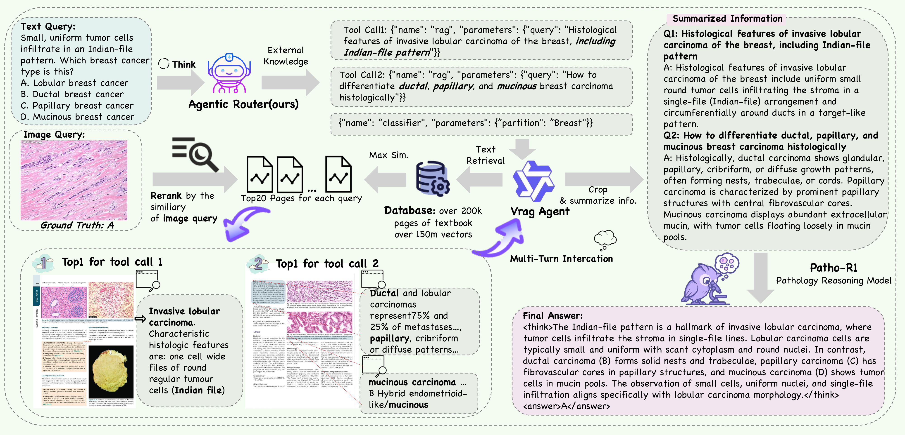

<div align="center" style="font-family: charter;">

<h1><i>Patho-AgenticRAG</i>:</br>Towards Multimodal Agentic Retrieval-Augmented Generation for Pathology VLMs via Reinforcement Learning</h1>



<br />

<a href="https://arxiv.org/abs/2508.02258" target="_blank">
    
</a>
<a href="https://huggingface.co/WenchuanZhang/Agentic-Router">
  
</a>
</div>

## Introduction📝
**Vision Language Models** have demonstrated significant potential in medical imaging tasks, but pathology presents unique challenges due to its ultra-high resolution, complex tissue structures, and nuanced clinical semantics. These challenges often lead to **hallucinations** in VLMs, where the outputs are inconsistent with the visual evidence, undermining clinical trust. Current **Retrieval-Augmented Generation (RAG)** approaches predominantly rely on text-based knowledge bases, limiting their ability to effectively incorporate critical visual information from pathology images.

To address these challenges, we introduce **Patho-AgenticRAG**, a **multimodal RAG framework** that integrates page-level embeddings from authoritative pathology textbooks with **joint text-image retrieval**. This approach enables the retrieval of textbook pages containing both relevant textual and visual cues, ensuring that essential image-based information is preserved. Patho-AgenticRAG also supports advanced capabilities such as **reasoning**, **task decomposition**, and **multi-turn search interactions**, improving diagnostic accuracy in complex scenarios.

Our experiments demonstrate that Patho-AgenticRAG significantly outperforms existing multimodal models in many tasks such as multiple-choice diagnosis and visual question answering.

## Updatas🔬
- [x] `2025-11-08`: Congratulations! 🎉🎉🎉 Patho-AgenticRAG has been accepted by AAAI 2026🎯
- [x] `2025-08-04` 🌟: Release Paper

## Installation🛠️
```bash
# Create and activate a new conda environment
conda create -n patho-agenticrag python=3.10 -y  
conda activate patho-agenticrag

# Clone the repository and install dependencies
git clone https://github.com/Wenchuan-Zhang/Patho-AgenticRAG.git
cd Patho-AgenticRAG
pip install -r requirements.txt

# Install Milvus Standalone with Docker and start Milvus
curl -sfL https://raw.githubusercontent.com/milvus-io/milvus/master/scripts/standalone_embed.sh -o standalone_embed.sh
bash standalone_embed.sh start
```

#  Patho-AgenticRAG Workflow🏃
This document outlines the workflow for setting up and running the **Patho-AgenticRAG** framework. The process involves the ingestion of pathology pdf images, model downloads, and serving the models for inference via API servers. Below are the steps to follow:
## 1. Milvus Ingestion
To ingest pathology images into Milvus for searching:
```bash
python milvus_ingestion.py
```
## 2. Milvus Search Engine API
Next, run the Milvus search engine API to handle the retrieval process:
```bash
python milvus_search_engine_api.py
```
## 3. Model Download
Download the necessary models from Hugging Face. These models are critical for the workflow and should be stored locally.
- Agentic-Router:
```bash
hf download WenchuanZhang/Agentic-Router --local-dir ./models/Agentic-Router
```
- VRAG-Agent:
```bash
hf download autumncc/Qwen2.5-VL-7B-VRAG --local-dir ./models/Qwen2.5-VL-7B-VRAG
```
- Patho-R1:
```bash
hf download WenchuanZhang/Patho-R1-7B --local-dir ./models/Patho-R1-7B --token <your-token>
```
## 4. Serving the Models
You can now serve the models for inference using the following commands:
- Agentic Router (on CUDA device 1):
```bash
CUDA_VISIBLE_DEVICES=1 python3 -m vllm.entrypoints.openai.api_server --model ./models/Agentic-Router --port 8002 --host 0.0.0.0 --served-model-name Agentic-Router --tensor-parallel-size 1
```
- Qwen2.5-VL-7B-VRAG (on CUDA devices 2 and 3):
```bash
CUDA_VISIBLE_DEVICES=2,3 vllm serve ./models/Qwen2.5-VL-7B-VRAG --port 8003 --host 0.0.0.0 --limit-mm-per-prompt image=10 --served-model-name VRAG-Agent --tensor-parallel-size 2
```
- Patho-R1 (on CUDA devices 4 and 5):
```bash
CUDA_VISIBLE_DEVICES=4,5 python3 -m vllm.entrypoints.openai.api_server --model ./models/Patho-R1-7B --tokenizer ./models/Patho-R1-7B --port 8004 --host 0.0.0.0 --served-model-name Patho-R1 --tensor-parallel-size 2
```
## 5. Running the Demo
Finally, run the Patho-AgenticRAG script for a demo:
```bash
python patho_agenticrag.py
```

## Acknowledgements✨
We gratefully acknowledge the contributions of the open-source community, particularly the following projects which laid the foundation for various components of this work:

- [Qwen](https://github.com/QwenLM) for providing powerful vision language models that significantly advanced our multimodal understanding and generation capabilities.
- [VRAG](https://github.com/Alibaba-NLP/VRAG) for enabling high-quality visual reasoning and agent-based training frameworks.  
- [Milvus](https://github.com/milvus-io/milvus) for offering an efficient and scalable vector database that supports advanced search capabilities.  
- [Colpali](https://github.com/illuin-tech/colpali) for providing valuable tools for language model interaction and enhancement.  
- [LLaMA-Factory](https://github.com/hiyouga/LLaMA-Factory) for robust LLM training and fine-tuning pipelines.  
- [VERL](https://github.com/volcengine/verl) for valuable visual-language pretraining resources.  
- [DeepSeek](https://github.com/deepseek-ai) for high-quality models and infrastructure supporting text understanding.

We thank the authors and contributors of these repositories for their dedication and impactful work, which made our development of Patho-AgenticRAG possible.

## Citation❤️
If you find our work helpful, a citation would be greatly appreciated. Also, consider giving us a star ⭐ on GitHub to support the project!

```
@article{zhang2025patho,
  title={Patho-agenticrag: Towards multimodal agentic retrieval-augmented generation for pathology vlms via reinforcement learning},
  author={Zhang, Wenchuan and Guo, Jingru and Zhang, Hengzhe and Zhang, Penghao and Chen, Jie and Zhang, Shuwan and Zhang, Zhang and Yi, Yuhao and Bu, Hong},
  journal={arXiv preprint arXiv:2508.02258},
  year={2025}
}
```
